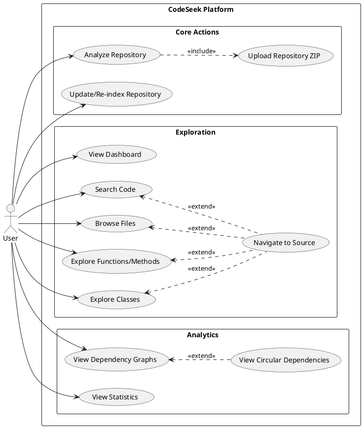
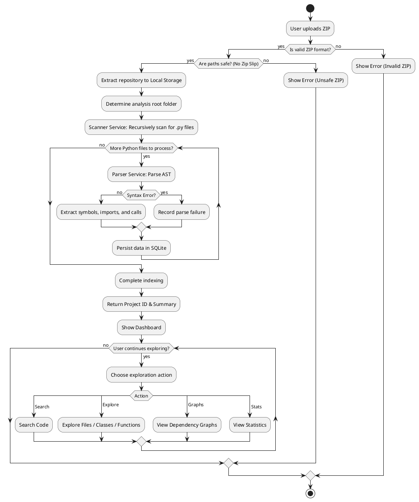
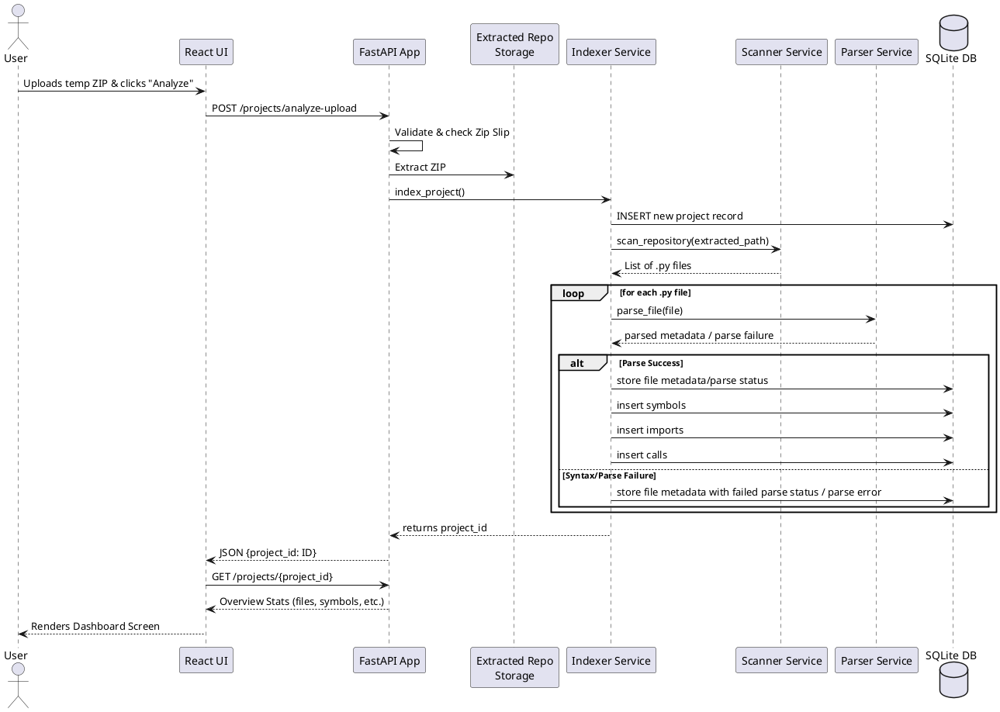
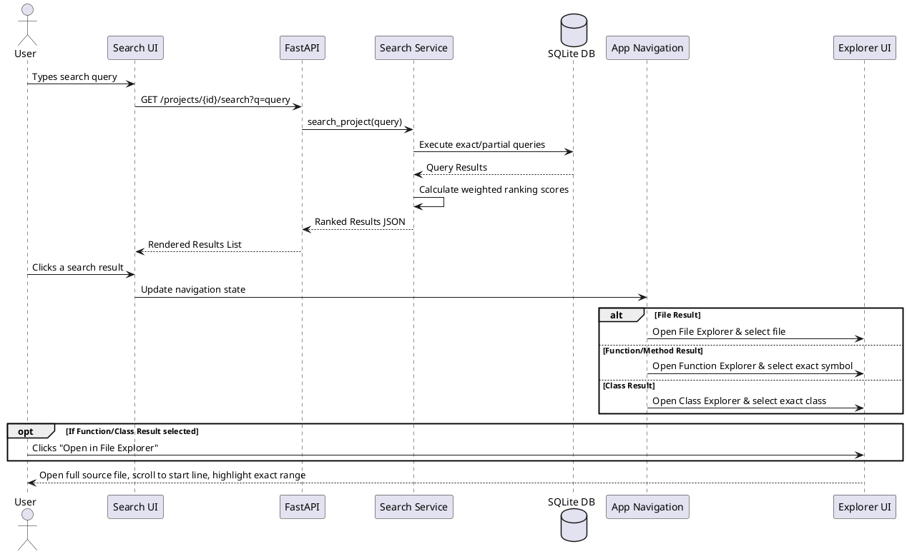
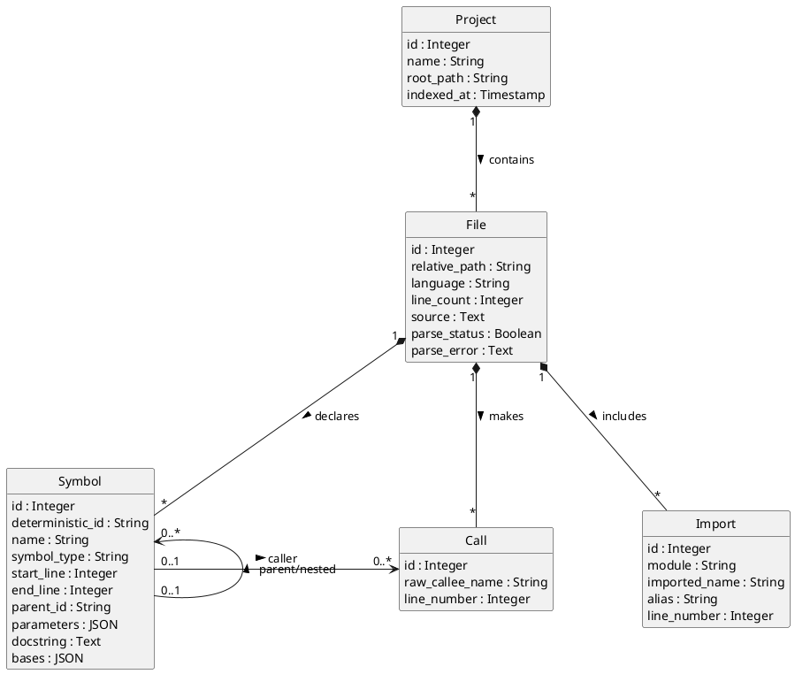
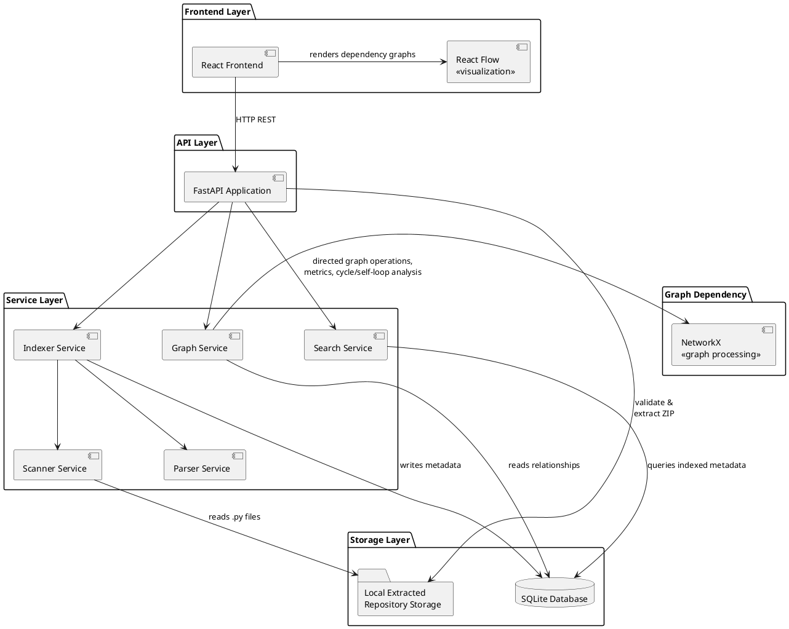
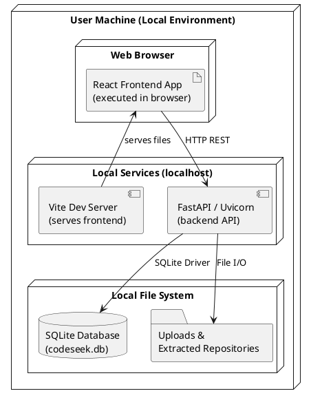
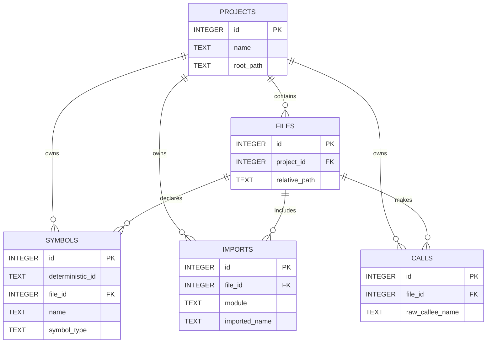

# CodeSeek Phase 2 UML Diagrams

> [!NOTE]
> These UML diagrams have been updated and corrected to accurately represent the **CURRENT implementation** of CodeSeek as a local, Python-based static analysis platform. The diagrams reflect actual service boundaries, conceptual data models, and features verified against the repository (including `graphs.py`, `core.py`, `indexer.py`, FastAPI routers, and React frontend capabilities).

---

## 1. Use Case Diagram

**Purpose**: Maps out the explicit ways an end-user interacts with the CodeSeek platform, capturing all core capabilities like uploading, exploring, searching, and viewing dependencies, while organizing features cleanly to reduce crossing lines.

*Viva Explanation*: The user interacts with CodeSeek by first analyzing a repository, which strictly includes uploading a ZIP. They can then independently use various explorers (Files, Functions, Classes, Graphs). Navigating directly to exact source lines extends searching or exploring. Circular dependency detection is an extended feature viewed within the graph interface.

---

## 2. Activity Diagram — Repository Analysis

**Purpose**: Details the complete control flow of the repository ingestion pipeline, from zip validation and extraction to AST parsing, SQLite storage, and sequential user exploration.

*Viva Explanation*: This shows the end-to-end flow. Crucially, it highlights security (Zip Slip validation) and fault tolerance: if one Python file has a syntax error, CodeSeek flags it as failed but continues parsing the rest of the repository without crashing. Upon completion, the user can sequentially choose various analysis actions.

---

## 3. Sequence Diagram — Upload & Indexing

**Purpose**: Shows the runtime messaging and module interactions during project ingestion, strictly reflecting `indexer.py` implementation where parsing occurs prior to file insertion.

*Viva Explanation*: The ZIP is temporarily uploaded and extracted securely. The extracted repository is retained as local storage. The Indexer orchestrates the Scanner and Parser. Service modules are invoked sequentially, and data is aggressively persisted to SQLite. Raw source viewing uses SQLite's stored source data.

---

## 4. Sequence Diagram — Search & Source Navigation

**Purpose**: Focuses on the user capability of globally searching the structured index and navigating precisely to matched source code lines, optionally opening the File Explorer for deeper context.

*Viva Explanation*: When a user searches, the Search Service queries SQLite and applies structural ranking logic (e.g., exact class names score higher than raw text). Clicking a result triggers React state changes to open the appropriate explorer. For symbol results, users can optionally switch to the File Explorer, which scrolls and highlights the exact lines.

---

## 5. Conceptual Data Model Class Diagram

**Purpose**: Represents the core persisted entities in CodeSeek, matching the real schema from `backend/app/database/core.py` with simplified, strict compositional hierarchies.

*Viva Explanation*: Shows how the metadata is cleanly structured hierarchically. A single project is composed of many files. Each file acts as the primary parent composed of symbols, imports, and calls. Symbols additionally hold associations identifying which specific calls they make or which nested symbols they contain.

---

## 6. Component Diagram

**Purpose**: Shows the distinct architectural components, modules, external dependencies, and how they communicate orthogonally.

*Viva Explanation*: CodeSeek is highly modular. The frontend leverages React Flow for visualization. The FastAPI application groups and delegates logic to Python services (Scanner, Parser, Indexer). Graph logic relies on NetworkX for mathematical directed graph operations and cycle detection, while unresolved reference logic is owned purely by Graph Service.

---

## 7. Deployment Diagram

**Purpose**: Illustrates the physical/logical local deployment environment for CodeSeek, distinguishing browser execution from local dev servers.

*Viva Explanation*: CodeSeek currently runs locally. Its frontend executes in the browser (served locally by Vite), while the backend API, database, and repository data remain securely on the user's local machine.

---

## 8. Optional Entity Relationship Diagram (ERD)

**Purpose**: Alternative database schema visualization utilizing Mermaid.js.

